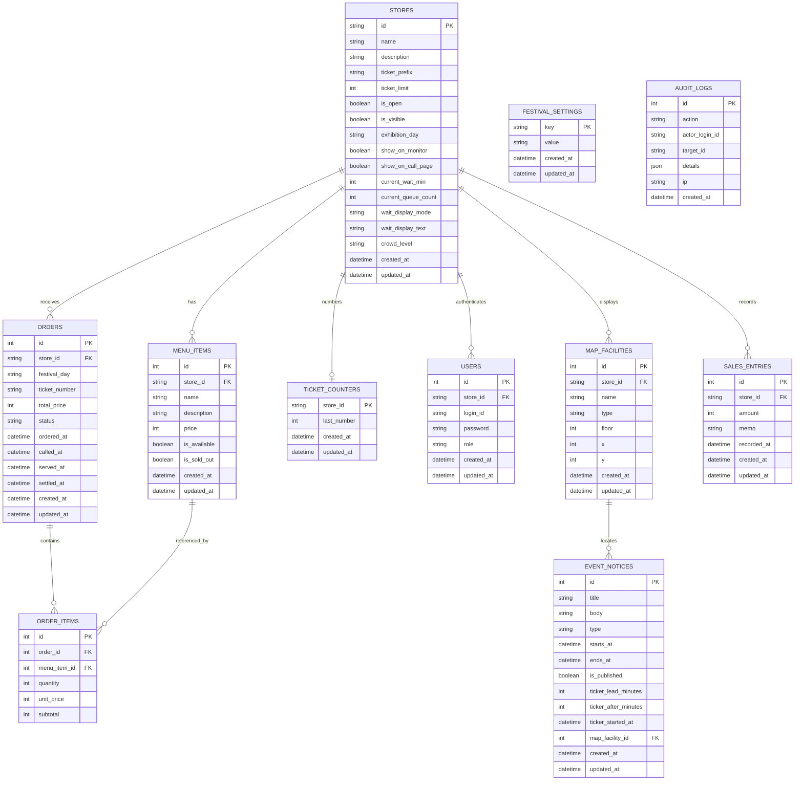

# データベースER図

`docs/database.md` のテーブル定義と、現行の Laravel マイグレーションをもとにした ER 図です。

## 補足

- `stores` は店舗・ブースの基本情報、待ち時間、出展日、モニター／呼び出し表示を持つ
- `orders` と `order_items` は店舗レジでの会計・受付番号発行を表す（来場者の事前モバイルオーダーではない）
- `users` は店舗ログイン（`role=store`）と管理者ログイン（`role=admin`）を兼ねる。管理者の `store_id` は null
- `ticket_counters` は店舗ごとの受付番号採番用カウンタ
- `map_facilities` は校内マップ上の施設・ブース位置を表す（`store_id` は null 可）
- `sales_entries` は店舗が手入力する当日売上
- `event_notices` はイベント／お知らせとホーム電光掲示板の元データ
- `festival_settings` は開催日など全体設定（例: `current_day`）
- `audit_logs` は管理操作・ログインなどの監査ログ
