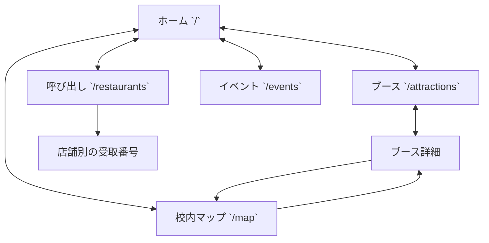
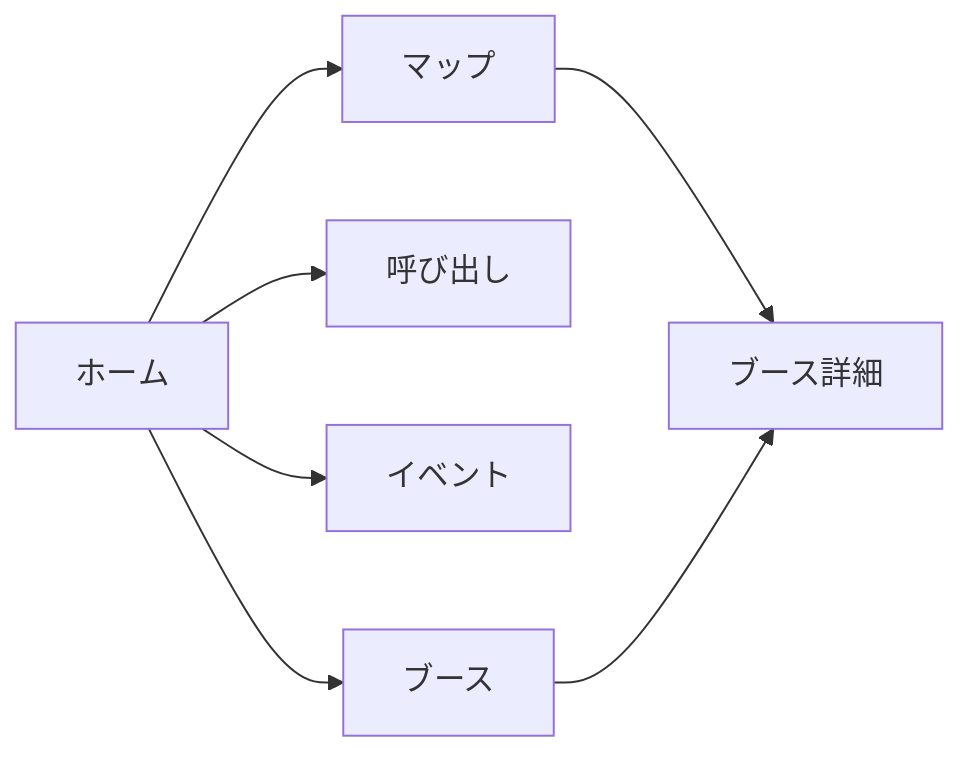
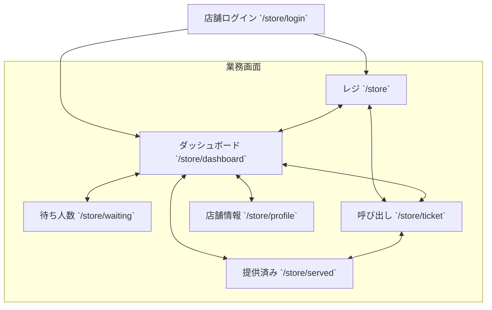
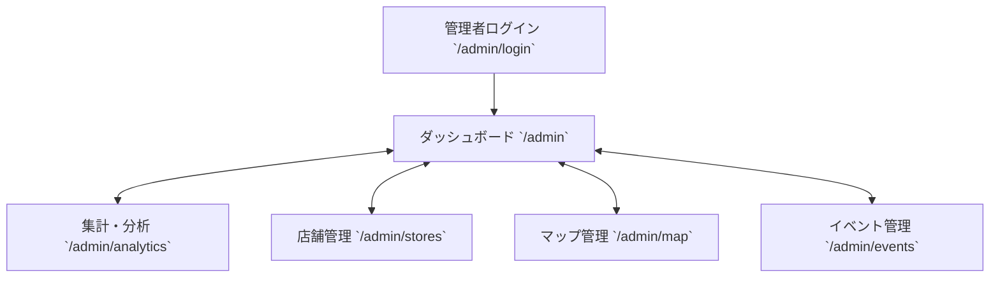
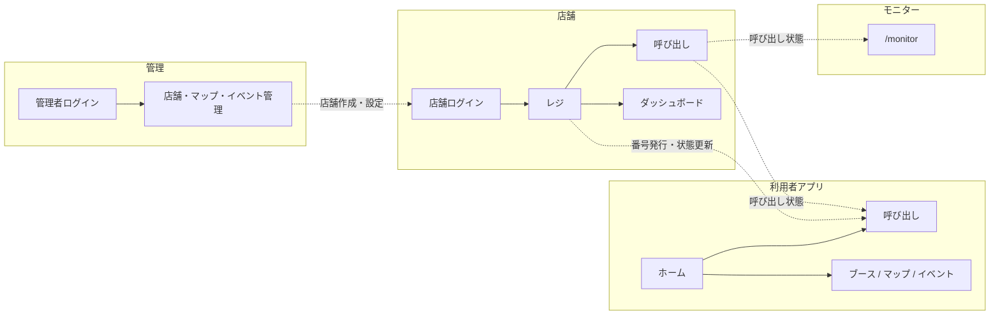

# 画面遷移図

画面遷移の元資料は Excel 上のラフ案。本ドキュメントはその清書版であり、現行の `frontend/src/app/routes.tsx` に合わせて更新している。

> **凡例**  
> - `↔` … 双方向遷移（行き来できる）  
> - `→` … 一方向遷移  
> - 下部タブ … 来場者向け共通ナビ（ホーム / ブース / 呼び出し / イベント / マップ）

---

## 1. 利用者側（アプリ）

来場者にログインは不要。下部タブで主要画面を行き来する。

### 画面一覧（利用者）

| 画面 | パス | 概要 |
|------|------|------|
| ホーム画面 | `/` | 各機能へのハブ、電光掲示板 |
| ブース一覧 | `/attractions` | 出店ブースの一覧・詳細 |
| 呼び出し | `/restaurants` | 店舗別の受取番号・呼び出し状況 |
| イベント | `/events` | イベント・お知らせ |
| 校内マップ | `/map` | フロア切替・ブース位置 |
| ブース詳細 | （ブース／マップ内） | ブース情報・マップへの導線 |

### 主経路

店頭で購入・番号発行後、アプリでは **呼び出し** を中心に利用する。モバイルオーダー・予約・来場者ログインは行わない。

---

## 2. 店舗側（`/store/*`）

### 画面内機能（サブ項目）

#### ダッシュボード

| 機能 | 説明 |
|------|------|
| 待ち人数 | 待ち行列の人数表示 |
| 先頭番号 / 最新発行番号 | 呼び出し・発行状況 |
| 目安待ち時間 | 待ち時間の目安表示 |
| 各画面への導線 | レジ・呼び出し・待ち人数・提供済み・店舗情報 |

#### レジ

| 機能 | 説明 |
|------|------|
| メニュー追加 / 編集 / 削除 | 商品管理 |
| 売り切れ切替 | 商品の売り切れ状態 |
| 会計・受付番号発行 | 店頭購入の会計と番号発行 |

### 店舗画面一覧

| 画面 | パス | 概要 |
|------|------|------|
| 店舗ログイン | `/store/login` | 店舗アカウント認証 |
| レジ | `/store` | メニュー管理・会計・受付番号発行 |
| ダッシュボード | `/store/dashboard` | 待ち状況・各画面へのハブ |
| 待ち人数 | `/store/waiting` | 待ち人数の ±1 調整 |
| 呼び出し | `/store/ticket` | 番号の呼び出し・提供完了・大きく表示 |
| 提供済み | `/store/served` | 提供済み履歴 |
| 店舗情報 | `/store/profile` | 店舗情報の表示・編集 |

※ 店舗の新規登録は公開せず、管理画面（`/admin`）から作成する。

---

## 3. 管理側（`/admin/*`）

| 画面 | パス | 概要 |
|------|------|------|
| 管理者ログイン | `/admin/login` | 管理者アカウント認証 |
| ダッシュボード | `/admin` | 総収益など概要 |
| 集計・分析 | `/admin/analytics` | 集計・可視化 |
| 店舗管理 | `/admin/stores` | 店舗の作成・編集・非表示化 |
| マップ管理 | `/admin/map` | マップ施設の管理 |
| イベント管理 | `/admin/events` | イベント・お知らせの管理 |

---

## 4. その他

| 画面 | パス | 概要 |
|------|------|------|
| 呼び出し番号モニター | `/monitor` | 校内プロジェクター向け一覧（認証不要） |

---

## 5. 全体像（利用者 × 店舗 × 管理）

店舗で発行した番号・呼び出し状態が、利用者の **呼び出し** 画面と校内モニターに反映される（詳細は `database.md`・`api.md` を参照）。

---

## 6. 改版履歴

| 版 | 日付 | 内容 |
|----|------|------|
| 0.1 | 2026-05-16 | Excel ラフ案をもとに Mermaid で清書 |
| 0.2 | 2026-11-21 | 現行ルートに合わせて更新（呼び出し・イベント・admin・monitor。モバイルオーダー／公開店舗登録を削除） |
